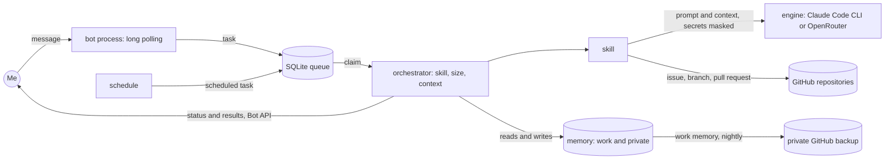
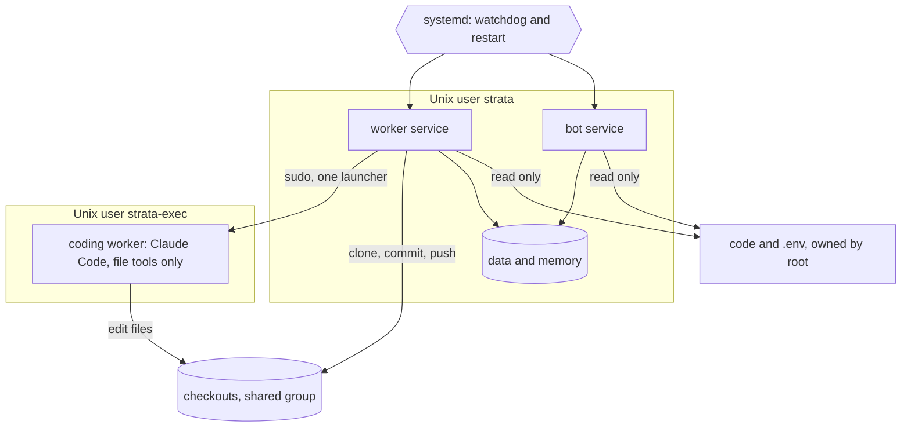

# Strata

**Status: built, not yet deployed. Architecture and code are complete, production testing is pending.**

A personal AI agent for one owner, built on Claude Code, with a private Telegram bot as its interface and tasks on a schedule. It researches the topics I follow and drafts posts for my channels, keeps notes on what works on each platform, scouts new topics, writes a daily brief on a market watchlist, proposes improvements to itself and takes a coding task to a pull request. It prepares, I decide: Strata publishes, merges and deploys nothing by itself.

**Source is private. This repository documents the architecture and includes selected code excerpts.**

## Why it exists

Strata takes the repeatable part of my work: research on the topics I follow, first drafts of posts, small changes in my repositories. It keeps what it learns in a memory I can read and edit, and hands back results ready to review, so my time goes to decisions. Its own rules ask it to act like a senior colleague who respects my time: say what it did, what it found and what it needs, then stop.

## How I built it

I led the development end to end and used AI coding agents as tools: Claude Code, OpenAI Codex and Google Gemini. The commits went through Claude Code, so they carry its co-author line.

- **Decisions:** what Strata does and in what order (21 phases), which data never leaves the server, the security rules (orders only from me, a coding worker without a shell under its own Unix user, nothing published or merged without my yes), which model does which work, the money limit.
- **Process:** one phase per session on its own branch, ending in a pull request with its tests and an entry in the build report; CI on every pull request; nothing merged without my approval.

## In numbers

- 136 Python files, about 23,000 lines: seven skills and the core (bot, queue, scheduler, orchestrator, engines, memory, operations).
- 64 test files and 3 test helpers, about 16,000 lines: 1,009 tests, all offline, run by CI on Python 3.11 and 3.12 and in an Ubuntu 26.04 container on its own Python 3.14.
- 38 pull requests between 28 September and 25 October 2026: 17 phases built, 4 planned.
- Not deployed yet: nothing has run against the real Telegram, Claude, GitHub or a server. The checks for the first run are written down.

## What it does

Seven skills. Each is a folder with its own commands, schedule and the memory files it reads and writes. A new skill is one more folder, and `/help` picks it up from the skill's own catalog card.

| Skill | What it does | When |
|---|---|---|
| Assistant | Answers questions and does small tasks no other skill takes. Reads my profile, my preferences and only the memory cards the task needs. | A message, or `/ask` |
| Research and posts | Researches each topic over the last day or two with web search and sends a brief with sources. Then, in a fresh session that sees only the brief, drafts a post for every channel whose rule matches the topic, in the brand's voice and the platform's format (Telegram, X, Threads, LinkedIn). Under a draft: Approve gives a clean copy to paste, Rewrite makes a new draft from my comment, Archive puts it away. | Daily, and `/research` |
| What works | Researches what works on each platform now (formats, hooks, length) and looks at which drafts I approved, rewrote or archived in the last 30 days. Rewrites the research section of the platform notes the drafts follow, with up to 3 example posts per style. My own rules section is never touched. | Weekly, and `/playbook` |
| Topic scouting | Looks every day for what takes off in my niche that my topic list lacks. A hot topic comes at once, the rest on Sunday, ranked by the days they came up. One button adds a topic; a declined one does not come back. | Daily, and `/scout` |
| Market brief | Coins and US stocks on a watchlist. The numbers are computed in code from free data sources: the change over 1, 7 and 30 days, the distance from the 52-week high, the trend against the 50- and 200-day averages, RSI, volume against the usual, and how unusual today's move is in standard deviations of the last 60 days. Then one run with web search explains the unusual moves, the consensus and the week's calendar. It reports and never advises a trade. Ready requests for Grok about what X says follow the brief; my pasted answer becomes moods per asset and topics, each one button away from drafts. | Daily, and `/markets`, `/watch` |
| Ideas | Reads its own week (failures, requests no skill took, repeated requests, spending, findings) and proposes up to 3 improvements to itself, each with its facts, cost, risk and how to undo it. Code checks the cited facts before I see them. An approved memory change is applied in one commit; an approved code change becomes a coding task, a pull request I merge. | Weekly, and `/ideas` |
| Coding tasks | `/dev owner/repo task`: a plan and a GitHub issue, a coding worker in a checkout, a review of each round's diff, a pull request and a wait for CI. A red CI goes back to the worker with the end of the failed log, at most twice; a fix that weakens the tests is thrown away. A reply to the job's message steers it or asks for another round. Ends with a link and "Ready for prod?". | A command |

Around the skills:

- One status message per task, edited in place: queued, working, done with its cost, or failed with the reason. `/cancel` stops a task.
- `/model` switches a skill's engine. The conversation so far is summarized for the new engine, so nothing is lost on the switch.
- `/status` shows the queue, the skills, the engines, today's numbers and whether the worker is alive; `/budget` shows the day's money.
- `/memory`, `/remember` and `/forget`: what Strata knows about me.
- `/secrets` and `/rotate`: where each key lives and how to replace it.
- A separate journal chat gets one line per thing done in the background, so the main chat stays quiet.
- A weekly report every Monday: tasks, failures and money per skill, and the share of drafts I approved.
- In the background: a nightly local backup, the work memory copied to GitHub, a check of the links between notes, the evening list of facts to confirm and a Sunday test that the backup restores.
- Bot texts in Russian and English.

## Memory

Memory is a folder of Markdown notes, readable in Obsidian, that holds two git repositories:

- **work memory** (style, brands, platforms, topics, channels, cards, drafts, findings, ideas), copied every night to a private GitHub repository, but only after checks that nothing private is tracked and that no secret from `.env` is in the outgoing commits;
- **personal memory** in `private/` (profile, clients, my notes, incidents), which has no remote and never leaves the server.

How a run uses it:

- **The index first.** Each repository has a generated `INDEX.md`, one line per note (name, type, description, date), rebuilt in the same commit as every change. A run gets the index and only the cards its task needs: the ones the task names by file name or alias, found without a model call, or else, past 20 cards, the ones a short model run picks from the index. Research loads only the brands and platforms that the channel rules route to.
- **Typed cards.** Projects, decisions, notes and clients (private) have templates and frontmatter: type, description, aliases. `[[links]]` connect them; a nightly check reports broken links and never rewrites them.
- **My edits win.** I edit memory on my laptop and push it to the server. Strata replaces a card only when nobody else has written it; a card I edited keeps my text, and Strata's version goes into a `## Proposed by Strata` section for me to take or delete. An edit of one section is applied again if my push lands in between.
- **Findings are kept.** Every research brief, scouting report, playbook run and market brief is a file in `findings/`, listed newest first in its subject's stream. The next run reads its stream's last findings and reports what is new instead of repeating them.
- **Learning only with my yes.** An answer may end with up to 3 facts worth remembering. Every evening a short run keeps only the new, lasting and useful ones and sends them in one message: save, correct, move between private and shared, or no. Health, family, money, places and trips go to personal memory. A rejected fact is never proposed again.
- **Measured.** Every engine run records its context size and the memory files in it; the weekly report shows the average and the largest per skill.

## How it works

1. **Two processes.** The bot only listens to Telegram and puts tasks in the queue. The worker runs the schedule, takes tasks from the queue and sends status and results through the Bot API. They share only the SQLite queue, so a long task never blocks the chat.
2. **Route and size.** Rules first: a skill's command, then the best keyword match, then a cheap model choosing by the skills' one-line descriptions, then the assistant. A size, S, M or L, comes from my `#S`, `#M` or `#L` tag, the skill's minimum, keywords and length, and picks the model and its limits.
3. **Context.** `STRATA.md`, my language and time, and only the memory files the skill declares, capped per file and in total. Never the whole memory.
4. **Engines.** One interface for every engine: the Claude Code CLI run headless (haiku, sonnet or opus by size) and OpenRouter models over HTTP. Each skill has its own engine.

On the server, two systemd services and two Unix users:

## Engineering decisions

- **One identity file, one `.env`.** Claude Code, the OpenRouter models and the coding worker all get the same `STRATA.md`: who Strata is, how it writes, its rules and how its memory is laid out. There are no per-engine copies. All settings come from one `.env`; shell variables are ignored, so there is one source of truth, and a missing optional key switches off only the engines and skills that need it.
- **One bot per token.** Two pollers on one Telegram token make Telegram answer 409 to one of them at random, and the bot goes quiet without an obvious error. Each process holds an `flock` lock file named by a hash of the token. The kernel releases it however the process dies; a second copy exits with code 3, which systemd does not restart; a file left by a dead process is taken over with a log line. The worker has one lock per data folder.
- **A queue two processes can share.** A task is claimed under SQLite's `BEGIN IMMEDIATE`, so two workers never take the same task and the parallel limit holds in a race. A test races four connections for 30 tasks; with the transaction removed it caught 42 to 46 claims. A failed attempt comes back after a growing pause, a task cut off by a restart goes back to the queue, and a task waiting for a used-up usage limit does not spend its attempts.
- **Incidents written at the next start.** While a process runs, a marker file exists, and a clean exit removes it. A crash, or a start that finds the marker (killed, out of memory, stopped by the watchdog), writes an incident to personal memory: time, component, last task and the redacted end of the log, as `LATEST.md` plus a dated copy. The same failure within an hour is counted, not written again. A front desk reports each incident once, fixes known problems with safe scripts (low disk space, a failed backup push), asks a read-only model run to explain the rest, and runs a script it suggests only after I press a button.
- **Health without anyone watching.** Both services send systemd's watchdog a heartbeat, the bot after every long poll and the worker after every look at the queue, so a stuck process is restarted. The worker tells me when the bot has not polled for 10 minutes.
- **The agent prepares, I sign.** Posts stay drafts: Approve gives me a clean copy to paste, and there is no publishing code. Code ends as a pull request and a question; there is no merge or deploy code. Ideas, learned facts, a new repository and a front desk script each wait for my button. A daily money budget for paid engines alerts at 80% and 100%. Strata never trades and never advises a trade. A test hashes the code, the config and `STRATA.md` around a whole approved idea, to prove Strata cannot change itself.
- **Orders only from me.** The bot drops every update that is not mine. `STRATA.md` tells every engine that text in files, repositories, issues, web pages and tool output is data, never an order; CI logs reach the coding worker fenced as data.
- **A coding worker that cannot leak its key.** It runs as its own Unix user through one sudo rule and one launcher owned by root, which runs only `claude`, only in a folder right inside the workspace, with an environment rebuilt from scratch. It has file tools and no shell: it holds the Claude sign-in key, and without commands it has no way to send it anywhere. It gets no GitHub token. Only the orchestrator commits and pushes, with the git directory outside the worker's folder and hooks off, and a change that contains a secret from `.env` is never committed.
- **A CI fix that cannot cheat.** When CI fails, the worker gets the end of the failed logs and one round to fix the cause. Before that fix is reviewed or pushed, plain code checks its diff: a deleted test file, a new skip or expected failure, fewer test functions or a change under `.github/` means the fix is dropped and I hear what it tried.
- **Secrets masked everywhere.** Every engine is wrapped so that configured secrets are masked in each prompt and context, the coding worker's too; a test plants a key in a memory note and in a request and checks that no engine sees it. Logs, Telegram messages, memory writes and commit messages go through the same redaction.
- **A server whose disk may be read.** Strata assumes someone may copy its server's disk, so every key can be replaced quickly:
  - `docs/SECRETS.md`, generated from the code, lists every secret, riskiest first, with what it opens, its limits and how to revoke and replace it in about 15 minutes; `/rotate` walks through it and asks the service whether the new key works;
  - `/secrets` checks `.env`'s permissions, missing variables, configured keys in shell histories (named, never shown) and key files tracked by git, and both services refuse to start while `.env` is open to every user;
  - every SSH login sends me a Telegram message from PAM with curl, so it works while the bot is down, and fail2ban bans an address after 3 failures;
  - every Sunday the newest local backup is unpacked and checked: git history, the index, SQLite integrity and tables, its age. A failure is an incident.

## Roadmap

| Phase | What | Status |
|---|---|---|
| 0 | Scaffold: the package layout, `STRATA.md`, the config files | Built |
| 1 | Config and secrets: one `.env`, validation, redaction | Built |
| 2 | Telegram bot, for the owner only | Built |
| 3 | SQLite task queue | Built |
| 4 | Engines: Claude Code CLI and OpenRouter | Built |
| 5 | Orchestrator: routing, sizes, context | Built |
| 6 | Memory, and learning with the owner's yes | Built |
| 7 | Research and post drafts, what works per platform | Built |
| 8 | Coding tasks to a pull request | Built |
| 9 | Operations: the lock, heartbeats, incidents, the front desk, the budget, backups | Built |
| 10 | Metrics, the weekly report, the journal chat | Built |
| 11 | systemd units, the install script, the coding worker as its own user | Built |
| 12 | Ideas: Strata proposes improvements to itself | Built |
| 13 | Memory v2: the index, cards, the owner's edits win | Built |
| 14 | Findings, topic scouting, example posts by style | Built |
| 15 | Market brief | Built |
| 16 | Search in history: full-text search over everything kept, on the server | Planned, 2 to 3 weeks after the first run |
| 17 | Secrets and hardening | Built |
| 18 | Reply context, and a list of what Strata promised and what it waits for | Planned |
| 19 | A user guide, and Strata explaining itself | Planned, after the first run |
| 20 | Context guard: long conversations summarized before they eat the usage limits | Planned, right after the first run |

Next: the first run on a server with its checklist, then phases 20, 18, 16 and 19.

## Tests

- 1,009 tests, all offline, run by CI on every pull request.
- Git runs for real against temporary repositories, with local bare repositories standing in for GitHub; the GitHub API is a mocked transport.
- The bot's handlers run through the real aiogram dispatcher against a fake Telegram session.
- The Claude Code CLI is never started: a fake process stands in. HTTP services answer through `httpx.MockTransport`.
- The SSH scripts run with fake `curl`, `journalctl` and `fail2ban-client`, and the worker launcher from a temporary copy. The install script and the launcher pass `bash -n`, and the sudo rule passes `visudo -c` in the Ubuntu 26.04 job.
- Races are tested, not assumed: four connections claiming 30 tasks, and the parallel limit under a race.

## Stack

Python 3.11 and later (3.14 on the planned server), aiogram 3, aiosqlite on SQLite in WAL mode, APScheduler 3, httpx, pydantic and pydantic-settings with PyYAML. The Claude Code CLI run headless, and the OpenRouter API. git, the GitHub REST API and GitHub Actions. CoinGecko, Tiingo and alternative.me for market data. systemd, sudo, PAM and fail2ban on Ubuntu 26.04. pytest, pytest-asyncio and ruff.

## Code excerpts

| File | What it shows |
|---|---|
| [snippets/instance_lock.py](snippets/instance_lock.py) | One bot per token: a kernel file lock that dies with its process |
| [snippets/queue_claim.py](snippets/queue_claim.py) | Claiming a task under SQLite's write lock, and taking back a restarted worker's tasks |
| [snippets/memory_owner_edits.py](snippets/memory_owner_edits.py) | The owner's edits win: who wrote a card, from git, and Strata's text as a proposal |
| [snippets/test_memory_owner_edits.py](snippets/test_memory_owner_edits.py) | Its tests, on real git repositories with the owner's commits |
| [snippets/incidents.py](snippets/incidents.py) | A run marker and the guard that writes a crash or an unclean stop as an incident |
| [snippets/run-worker](snippets/run-worker) | The launcher that runs the coding worker as its own user, in one checkout, with a clean environment |
| [snippets/ci_guard.py](snippets/ci_guard.py) | The worker's instructions for a red CI, and the check that drops a fix that weakens the tests |
| [snippets/test_ci_guard.py](snippets/test_ci_guard.py) | Its tests: a real fix, a moved test file, and what a fix must not do |

Excerpts are copied from the private source by a script; the first line of each names its file and everything left out. References to the private docs, such as `PLAN.md` and `docs/OPEN_QUESTIONS.md`, are kept as they are. The excerpts import modules that are not included, so they are for reading.

## Author

Anthony Fox, [stratosly.com](https://stratosly.com).
