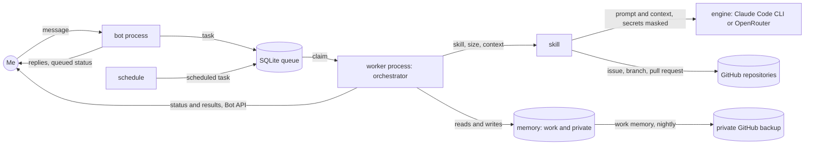
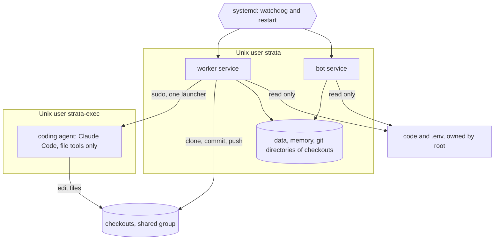

# Strata

**Status: built, not yet deployed. Architecture and code are complete, production testing is pending.**

A personal AI agent for one owner. I talk to it through a private Telegram bot, and it does its work on the Claude Code CLI (headless) and OpenRouter models, on request and on a schedule. It researches the topics I follow and drafts posts for my channels, learns what works on each platform, scouts new topics, writes a daily brief on a market watchlist, proposes improvements to itself and takes a coding task to a pull request. It prepares, I decide: Strata publishes, merges and deploys nothing by itself.

Most of the engineering is in the guardrails: two processes that share one SQLite queue, memory in git where my edits win, a coding agent with no shell under its own Unix user, and secrets masked before any model sees them.

**Source is private. This repository documents the architecture and includes selected code excerpts.**

## How I built it

I led the development end to end and used AI coding agents as tools: Claude Code, OpenAI Codex and Google Gemini. The commits went through Claude Code, so they carry its co-author line.

- **Decisions:** the scope and order of the work (21 phases), which data never leaves the server, the security rules (orders only from me, a coding agent without a shell under its own Unix user, nothing published or merged without my approval), which model handles which work, the daily spending limit.
- **Process:** each phase was one session on its own branch, ending in a pull request with its tests and an entry in the build log; CI from the second pull request on; I approved every merge.

## In numbers

- 136 Python files, about 23,000 lines: seven skills and the core (bot, queue, scheduler, orchestrator, engines, memory, operations).
- 1,009 tests, all offline, in 64 files and 3 helpers of about 16,000 lines, run by CI on Python 3.11, 3.12 and 3.14 (one test, of the sudo rule, needs root and is skipped on 3.11 and 3.12).
- 38 pull requests from September 28 to October 25, 2026: 17 of 21 phases built.
- Nothing has run against the real Telegram, Claude, GitHub or a server yet; the first-run checks are written down.

## How it works

- **Two processes.** The bot process answers me, handles commands and buttons and queues tasks. The worker process runs the schedule, takes tasks from the queue and sends status and results through the Bot API, so a long task never blocks the chat.
- **Routing.** A task goes to a skill by its command, else by keywords, else by a cheap model choosing from the skills' one-line descriptions, else to the assistant. Its size, S, M or L, picks the model and its limits.
- **Context.** `STRATA.md`, my language and local time, and only the memory files the skill declares, capped per file and in total.
- **Engines.** One interface for the Claude Code CLI (Haiku, Sonnet or Opus by size) and OpenRouter models. Each skill has its own; `/model` switches it.

More on the processes, routing and engines, and the server layout

- The two processes share the data folder (the queue, the drafts database, heartbeat and incident files) and memory.
- The size comes from my `#S`, `#M` or `#L` tag, the skill's minimum, keywords and the length of the request.
- On `/model`, the conversation so far is summarized and the new engine continues from that summary.

On the server, two systemd services and two Unix users:

## What it does

| Skill | What it does | When |
|---|---|---|
| Assistant | Answers questions and does small tasks, knowing my profile, my preferences and only the memory cards the task needs. | Any message, or `/ask` |
| Research and posts | Researches my topics with web search, sends a brief with sources and drafts a post for each channel in the brand's voice; Approve, Rewrite or Archive under each draft. | Daily, or `/research` |
| What works | Studies what works on each platform and which drafts I approved, then updates the notes the drafts follow. | Weekly, or `/playbook` |
| Topic scouting | Finds subjects rising in my niche that are not on my topic list; one button adds one. | Daily, or `/scout` |
| Market brief | Coins and US stocks on a watchlist: the numbers computed in code, the reasons from a run with web search, never advice to trade. | Daily, or `/markets` |
| Ideas | Proposes up to 3 improvements to itself from its own week, each with its facts, cost, risk and how to undo it. | Weekly, or `/ideas` |
| Coding tasks | Takes a task in a repository to a pull request: a plan, an issue, the coding agent, a review of each round, CI, then "Ready for prod?". | `/dev owner/repo task` |

Each skill in detail, and what comes with them

Each skill is a folder of code with its own catalog card, plus an entry in `config/skills.yaml` with its engine, commands, schedule and the memory files it may read. A new skill is one folder and one entry, and `/help` lists it from its card.

- **Assistant.** Takes what no other skill takes. A plain message or `/ask`.
- **Research and posts.** Researches each topic over the last day or two with web search and sends a brief with sources. A fresh session that sees only the brief drafts a post for each matching channel, in the brand's voice and the platform's format (Telegram, X, Threads, LinkedIn). Under each draft: Approve gives a clean copy to paste, Rewrite makes a new draft from my comment, Archive puts it away.
- **What works.** Researches what works on each platform now (formats, hooks, length) and which drafts I approved, rewrote or archived in the last 30 days, then rewrites the research part of the platform notes, with up to 3 example posts per style. My own rules in those notes stay untouched.
- **Topic scouting.** A fast-rising subject comes at once, the rest on Sunday, ranked by the days they came up. A declined one is not proposed again for about two months.
- **Market brief.** The numbers come from code over free data sources (CoinGecko, Tiingo, alternative.me): the change over 1, 7 and 30 days, the distance from the 52-week high, the trend against the 50- and 200-day averages, RSI, volume against the usual, and today's move in standard deviations of the last 60 days. The run with web search then explains the unusual moves, the consensus and the week's calendar. Strata does not read X itself, so the brief ends with ready prompts for Grok; the answer I paste back becomes the mood per asset and a list of topics, each a button away from drafts. `/watch` edits the list.
- **Ideas.** Reads its week: failures, requests no skill took, repeated requests, spending, findings. Code checks the cited facts before I see them. An approved memory change is applied in one commit; an approved code change becomes a coding task, a pull request I merge.
- **Coding tasks.** A failed CI check goes back to the coding agent with the end of its log, one round at a time and at most twice. A reply to the job's message steers it or asks for another round.

What comes with the skills:

- one status message per task, edited in place: queued, working, done with its cost, or failed with the reason. `/cancel` cancels a task: a queued one never runs, a running one's result is dropped;
- `/status` (the queue, skills, engines, today's numbers, whether the worker process is alive) and `/budget` (today's spending);
- `/memory`, `/remember` and `/forget` for what Strata knows about me; `/secrets` and `/rotate` for the keys;
- a separate journal chat with one line per background step, so the main chat stays quiet;
- a Monday report: tasks, failures and spending per skill, and the share of drafts I approved;
- every night a local backup, the work memory copied to GitHub, a check of the links between notes and the evening list of facts to confirm; every Sunday a test that the backup restores;
- bot texts in Russian and English.

## Memory

Markdown notes in one folder, readable in Obsidian, in two git repositories: **work memory**, copied nightly to a private GitHub repository, and **personal memory** in `private/`, which has no remote and is never pushed off the server. A card is one note about one project, decision, subject or client.

- **The index first:** a run gets the index and only the cards its task needs, never the whole memory.
- **My edits win:** a card I edited keeps my text; Strata's version becomes a proposal inside it.
- **Findings are kept:** every brief and report is saved, and the next run reports only what is new.
- **Learning only with my approval:** facts worth remembering wait for my yes in an evening list.
- **Measured:** every run records its context size and the memory files in it.

How memory works in detail

- **Work memory** holds style, brands, platforms, topics, channels, cards, drafts, findings and ideas. Before the nightly copy, checks confirm that nothing private is tracked and that no secret from `.env` is in the outgoing commits.
- **Personal memory** holds my profile, clients, my notes and incidents. It is never pushed or backed up off the server; its notes reach a model only as the context of a skill that declares them.
- **Cards** have templates and typed frontmatter (type, description, aliases). `[[links]]` connect them; a nightly check reports broken links and never rewrites them.
- **The index.** Each repository has a generated `INDEX.md`, one line per note, rebuilt in the same commit as every change. The assistant gets the index and the cards the task names by file name or alias, matched in code, or else, past 20 cards, the ones a short model run picks. Research loads only the brands and platforms the channel rules route to.
- **My edits.** I edit memory on my laptop and push it to the server. Strata replaces a card only if nobody else has written it; otherwise its version goes into a `## Proposed by Strata` section for me to take or delete. A section edit is reapplied to the new text if my push lands between Strata's read and write.
- **Findings.** Every research brief, scouting report, platform report and market brief is saved in `findings/` and listed, newest first, in one note per subject. The next run on that subject reads the latest ones.
- **Learning.** An answer may end with up to 3 facts worth remembering. Every evening a short run keeps the new, lasting and useful ones and sends them in one message, where I save, correct, move between private and shared, or reject each. Health, family, money, places and trips go to personal memory; a rejected fact is never proposed again.
- **Measuring.** The Monday report shows the average and the largest context per skill.

## Engineering decisions

Each line opens to the details.

<b>One identity file, one <code>.env</code>.</b> Every engine gets the same rules; every setting comes from one file.

Claude Code, the OpenRouter models and the coding agent all get the same `STRATA.md`: who Strata is, how it writes, its rules and how its memory is laid out. There are no per-engine copies. All settings come from one `.env`; shell variables are ignored, and a missing optional key switches off only what needs it.

<b>One bot per token.</b> A kernel file lock stops a second poller before Telegram silences the bot.

Two pollers on one Telegram token make Telegram answer 409 to one of them at random, and the bot goes quiet without an obvious error. Each process holds an `flock` lock file named by a hash of the token. The kernel releases it however the process dies; a second copy exits with code 3, which systemd does not restart; a file left by a dead process is taken over with a log line. The worker process has one lock per data folder. Excerpt: [snippets/instance_lock.py](snippets/instance_lock.py).

<b>A queue two processes can share.</b> Claims under SQLite's write lock, with a race test that fails without it.

A task is claimed under `BEGIN IMMEDIATE`, so two workers never take the same task and the parallel limit holds in a race. A test races four connections for 30 tasks; with the transaction removed, the same race produced 42 to 46 claims. A failed attempt comes back after a growing pause, a task cut off by a restart goes back to the queue, and a task waiting for a usage limit to reset keeps its attempts. Excerpt: [snippets/queue_claim.py](snippets/queue_claim.py).

<b>Incidents, even after a hard kill.</b> A run marker turns a crash or a kill into an incident at the next start.

A marker file exists while a process runs, and a clean exit removes it. A crash, or a start that finds the marker (killed, out of memory, stopped by the watchdog), writes an incident to personal memory: time, component, last task and the redacted end of the log, as `LATEST.md` plus a dated copy. The same failure within an hour is counted, not written again. A triage step reports each incident once, fixes known problems with fixed safe scripts (low disk space, a failed backup push), asks a read-only model run to explain the rest, and runs one of those scripts on its advice only after I press a button. Excerpt: [snippets/incidents.py](snippets/incidents.py).

<b>Health without anyone watching.</b> Both processes report to systemd's watchdog.

The bot sends a heartbeat after every long poll and the worker after every look at the queue, so systemd restarts a stuck process. The worker tells me when the bot has not polled for 10 minutes.

<b>The agent prepares, I sign.</b> No code path publishes, merges or deploys; commitments wait for my button.

Approve on a draft gives me a clean copy to paste; the adapters for posting services are stubs that refuse. Code ends as a pull request and a question; there is no merge or deploy code. Ideas, learned facts, a new repository and a triage script each wait for my button. A daily spending limit on paid engines alerts at 80% and 100%. Strata never trades and never advises a trade. A test approves an idea and checks, by hashing the code, the config and `STRATA.md` before and after, that none of them changed.

<b>Orders only from me.</b> Text from files, web pages and tools is data, never an order.

The bot drops every update that is not mine. `STRATA.md` tells every engine that text in files, repositories, issues, web pages and tool output is data, never an order; CI logs reach the coding agent fenced as data.

<b>A coding agent that cannot run commands.</b> Its own Unix user, one launcher, file tools only, no GitHub token.

It runs as its own Unix user through one sudo rule and one root-owned launcher, which runs only `claude`, only in a folder right inside the workspace, with an environment rebuilt from scratch. It has file tools and no shell, so it cannot run a command that sends its Claude sign-in key out, and it gets no GitHub token. Only Strata commits and pushes, with the git directory outside the agent's folder and hooks off; a commit is refused when the change contains a secret from `.env` as written. Excerpt: [snippets/run-worker](snippets/run-worker).

<b>A CI fix that cannot quietly drop tests.</b> Plain code checks the agent's fix before it is reviewed or pushed.

When CI fails, the coding agent gets the end of the failed logs and one round to fix the cause. A deleted test file, a new skip or expected failure, fewer test functions or a change under `.github/` drops the fix, and I hear what it tried. These are pattern checks: they catch the usual shortcuts, not every way to weaken a test. Excerpt: [snippets/ci_guard.py](snippets/ci_guard.py).

<b>Secrets masked in prompts, logs and commits.</b> Every engine is wrapped, and a test plants a key to prove it.

Configured secrets are masked in each prompt and context, the coding agent's too; a test plants a key in a memory note and in a request and checks that no engine sees it. Logs, Telegram messages, memory writes and commit messages go through the same redaction.

<b>A server whose disk may be read.</b> A secrets inventory, key rotation, SSH login alerts and a weekly restore test.

- `docs/SECRETS.md`, generated from the code, lists every secret, riskiest first: what it opens, its limits and the steps to revoke and replace it, written to take about 15 minutes. `/rotate` walks through them and asks the service whether the new key works.
- `/secrets` checks `.env`'s permissions, missing variables, configured keys in shell histories (named, never shown) and key files tracked by git. Both services refuse to start while `.env` is open to every user.
- Every SSH login sends me a Telegram message from PAM with curl, so it works while the bot is down; fail2ban bans an address after repeated failures.
- Every Sunday the newest local backup is unpacked and checked: git history, the index, SQLite integrity and tables, its age. A failure is an incident.

## Roadmap

17 of 21 phases are built. Next: the first run on a server with its checklist, then phase 20 (context guard), 18 (reply context and a list of promises), 16 (search in history) and 19 (a user guide).

All phases

Built: 0 scaffold, 1 config and secrets, 2 Telegram bot, 3 SQLite queue, 4 engines, 5 orchestrator, 6 memory and learning, 7 research, drafts and what works, 8 coding tasks, 9 operations (the lock, heartbeats, incidents, triage, spending, backups), 10 metrics and the journal chat, 11 systemd units, the install script and the coding agent's own user, 12 ideas, 13 memory v2 (the index, cards, my edits win), 14 findings, scouting and example posts, 15 market brief, 17 secrets and hardening.

| Planned | What | When |
|---|---|---|
| 20 | Context guard: a long conversation is summarized and restarted at a set size and every night, so a resumed run stops re-reading its whole history | Right after the first run |
| 18 | Reply context, and a list of what Strata promised and what it waits for | After phase 20 |
| 16 | Search in history: full-text search over everything kept, on the server | 2 to 3 weeks after the first run |
| 19 | A user guide, and Strata explaining itself | After the first run |

## Tests

All offline: real git against local bare repositories standing in for GitHub, the real aiogram dispatcher against a fake Telegram, and fake processes in place of the Claude Code CLI and the server tools.

How each part is tested

- Git runs for real against temporary repositories, with local bare repositories standing in for GitHub; the GitHub API is a mocked transport.
- The bot's handlers run through the real aiogram dispatcher against a fake Telegram session.
- The Claude Code CLI is never started: a fake process stands in, and HTTP services answer through `httpx.MockTransport`.
- The SSH scripts run with fake `curl`, `journalctl` and `fail2ban-client`, and the launcher from a temporary copy; the install script and the launcher pass `bash -n`, the sudo rule `visudo -c`.

## Stack

Python 3.11 and later (3.14 on the planned server), aiogram 3, aiosqlite (SQLite in WAL mode), APScheduler 3, httpx, pydantic-settings with PyYAML; the Claude Code CLI and the OpenRouter API; git, the GitHub REST API and GitHub Actions; CoinGecko, Tiingo and alternative.me; systemd, sudo, PAM and fail2ban on Ubuntu 26.04; pytest, pytest-asyncio and ruff.

## Code excerpts

| File | What it shows |
|---|---|
| [snippets/instance_lock.py](snippets/instance_lock.py) | One bot per token: a kernel file lock |
| [snippets/queue_claim.py](snippets/queue_claim.py) | Claiming a task under SQLite's write lock, and recovery after a restart |
| [snippets/memory_owner_edits.py](snippets/memory_owner_edits.py) | My edits win: who wrote a card, from git, and Strata's proposal |
| [snippets/test_memory_owner_edits.py](snippets/test_memory_owner_edits.py) | Its tests, on real git repositories with my commits |
| [snippets/incidents.py](snippets/incidents.py) | The run marker, and the guard that records a crash or an unclean stop |
| [snippets/run-worker](snippets/run-worker) | The launcher of the coding agent: its own user, one checkout, a clean environment |
| [snippets/ci_guard.py](snippets/ci_guard.py) | The rules for a CI fix, and the check that drops one that drops tests |
| [snippets/test_ci_guard.py](snippets/test_ci_guard.py) | Its tests: a real fix, a moved test file, what a fix must not do |

A script copies the excerpts from the private source. The first line of each names its file and everything left out; references to private docs such as `PLAN.md` stay as they are. They import modules not included here, so they are for reading, not running.

## Author

Anthony Fox, [stratosly.com](https://stratosly.com).
